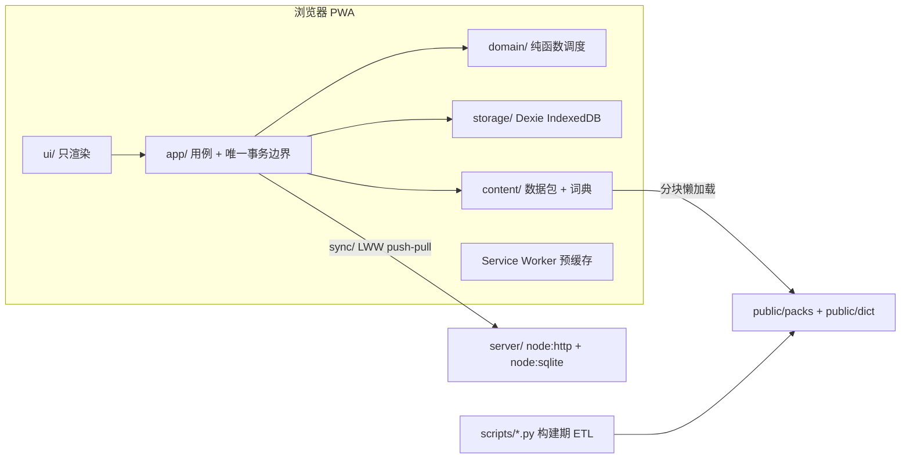

# ExamFlow Vocab

> 按**义项权重**决定学什么、按**考试日期**决定什么时候复习的雅思背单词 PWA。

离线优先（IndexedDB + Service Worker），可选自建零依赖后端实现账号与多设备同步。词汇数据全部在构建期生成，运行时不调用任何 AI（「AI 私教」面板仅在用户自备 OpenAI 兼容 Key 时启用）；词源「问 AI 核对」经自建后端代理（服务端环境变量 `OPENROUTER_API_KEY`）核对并写入词表，前端覆盖层即时生效。

| 状态 | 数据包 | 测试 | 门禁 | 许可 |
| :-- | :-- | :-- | :-- | :-- |
| M1 交付候选 | IELTS 2000 词 v1.6.0 | 前端 303 用例 / 后端冒烟 10 项 / E2E 9 项 | 6/6 通过 | Apache-2.0 |

**目录**：[亮点](#1-亮点) · [快速开始](#2-快速开始) · [功能](#3-功能) · [架构](#4-架构) · [数据与合规](#5-数据与合规) · [命令](#6-命令与脚本) · [质量保障](#7-质量保障) · [部署](#8-部署) · [已知缺口](#9-已知缺口) · [文档](#10-文档索引) · [参与开发](#11-参与开发)

---

## 1. 亮点

- **义项级优先**：同一个词的不同义项分别估算权重，熟词僻义单独成卡；学什么由 `senseWeight` 排序决定。
- **考期驱动调度**：ts-fsrs（FSRS-6）排间隔，再按考试日期硬截断 `I = min(I_fsrs, max(1, D-1))`；每日新词数按剩余天数反推，考前算不完会提前预警。
- **键盘 / 单手双通道**：桌面全键位完成一轮学习，移动端底部操作区、触摸目标 ≥ 44px。
- **可溯源的内容**：例句来自 Tatoeba 人工译句对，同义替换按 WordNet 义项分组，词根记忆链经 Wiktionary 核对；缺数据宁可留空，不用模板句凑数。
- **离线优先 + 可选同步**：本地 IndexedDB 是主副本；登录后逐行 LWW 双向同步，后端仅依赖 Node 内置模块。

## 2. 快速开始

环境：**Node ≥ 22.5**（后端使用内置 `node:sqlite`；只跑前端时 20.19+ 即可）。

```bash
npm install
npm run dev:full       # 前端 http://localhost:5173 + 后端 8787（/api 由 Vite 代理）
```

1. 打开 http://localhost:5173 → 设置考试日期 → 开始学习。
2. （可选）云同步：右上角设置 →「云同步」→ 注册 / 登录。之后每 30 秒自动同步，换设备登录同一账号即可恢复进度。

| 场景 | 命令 |
| :-- | :-- |
| 只跑前端（纯离线） | `npm run dev` |
| 只跑后端（`--watch`） | `npm run dev:api` |
| 生产构建并单端口启动 | `npm run serve` → http://localhost:8787 |
| 离线验证 | `npm run serve` 后在 DevTools → Application 检查已激活的 SW 与 Cache Storage 预缓存（dev 模式不启用 SW） |

```bash
# 后端自检
curl http://localhost:8787/api/v1/health
curl -X POST http://localhost:8787/api/v1/auth/register \
  -H 'Content-Type: application/json' \
  -d '{"username":"demo","password":"password123"}'
```

## 3. 功能

### 3.1 PRD 用户故事交付状态

| US | 用户故事 | 状态 | 实现要点 |
| :-- | :-- | :--: | :-- |
| US-01 | 学术常考词与义项优先 | 已交付 | 新卡按 `senseWeight` 降序入队（`sessionBuilder.buildSession`）；权重条 + 层级徽章 +「估计权重」标注；熟词僻义独立成卡（每词 ≤ 3 张）；「排除基础词」开关切换后重算计划 |
| US-02 | 每日计划与考前可达性 | 已交付 | `n_new = min(M_new, ceil(N / max(1, D-B)))`（`planner.planDaily`）；过轮窗口不引新卡；考期截断；`CANNOT_FINISH / BACKLOG / OVERRUN_WINDOW / EXAM_PAST` 四类警告；首页覆盖率统计 |
| US-03 | 键盘完成一轮学习 | 已交付 | `Space / 1 / 2 / 3 / C / Shift+C / X / Z / → / Enter / R / F` 全键位（`useStudyHotkeys.ts` + `HotkeyPanel`）；输入框聚焦与弹窗打开时屏蔽；可激活元素上让位原生激活，防双触发 |
| US-04 | 移动端单手完成学习 | 已交付 | 评分与「下一个」在底部操作区；触摸目标 ≥ 44px；适配 `safe-area-inset-bottom`；不禁用缩放；背面次要模块默认折叠 |
| US-05 | 形近词对比 | 已交付 | `lemma + 区分理由 + 要点` 默认折叠；点击弹出词条摘要浮层（`WordPreviewModal`，焦点陷阱 + Esc），不离开当前会话 |
| US-06 | 例句点词即查 | 已交付 | 背面例句逐词可点 → 词形还原 → 词条弹窗；库内词一键标星，库外词建自定义词条并生成新卡 |
| US-07 | 备份与恢复 | 已交付 | 单 JSON 导出 / 逐字段校验导入（`backupService.ts`）；超过 7 天备份提醒；`navigator.storage.persist()` + iOS「添加到主屏幕」引导 |
| US-08 | 同义替换可达性 | 已交付（v1.6.0） | 同义关系挂在义项上：按 WordNet synset 分组，每组带英文释义与搭配框架；学习卡只保留「需改写」徽章并给出改写模板（ADR-006 / ADR-009）。覆盖 1574 / 1999 词；PRD 标杆 `increase → surge` 仍不产出，见 [G-5](#9-已知缺口) |

### 3.2 补充能力

| 能力 | 说明 | 入口 |
| :-- | :-- | :-- |
| 拼写练习 | 逐字母实时校验、Tab 提示、练习日志；不影响识记卡调度 | `S` / 背面「拼写」 |
| 全量查词 | ECDICT 45,384 词按首字母分片懒加载，支持词形还原与前缀搜索；库外词可一键加入生词本（ADR-007） | 顶栏「词典」/ 任意词条弹窗 |
| 词根记忆链 | `con(一起) + sist(站) → 站到一起 → 由…组成`，链尾词义默认遮住；展开含**词义演变**（本义 → 现义的逐级推演）与**同根词拓展**（构词公式表，593 / 1999 上卡）；同根词只列 2–3 个已学过的（ADR-008 / ADR-009） | 背面词根区（`R`） |
| 词根库 | 242 个词根家族 / 4,037 个同根词，按词根、中文义或成员搜索 | 顶栏「词根」 |
| 易混词 / 雅思改写 | 人工高危易混清单优先，缺失时降级为「词形相近」；改写区按义项展示 2–3 条带中文的替换 | 背面形近 / 同义区（`F`） |
| 义项权重双 Tab | 「义项权重（估计）」与「英文释义」切换，当前义项高亮 | 背面词典区 |
| 全量例句 + 朗读 | Tatoeba 英中句对，当前义项优先；每句可朗读、可点词、可溯源句对编号 | 背面例句区 |
| 学习仪表盘 | 核心覆盖率、考试日预测、积压、近 7 日复习量、未来 7 天到期 | 顶栏仪表盘（桌面） |
| 入门水平测试 | 按权重分层抽样自评，认识的词标为已掌握，可在词库页恢复 | 仪表盘 → 入门水平测试 |
| 考点提炼 + 笔记 | 由义项权重 / 层级 / 熟词僻义推导考点提示，保留「我的笔记」 | 背面考点与笔记区 |
| AI 私教（可选） | 自备 OpenAI 兼容 Key：助记 / 例句拆解 / 形近词对比 / 自由提问；未配置时不提供模拟回答 | 右栏「AI 私教」 |
| 多词书 / 移动端导航 | 只列出已发布数据包的考试；窄屏（< 768px）顶栏页面菜单 | 顶栏 |

## 4. 架构



**三层纪律**

- **domain 纯函数**：不碰 DOM / IndexedDB，时钟可注入。
- **app 唯一事务边界**：`db.transaction` 只允许出现在 `src/app/transactions.ts`（门禁 5）。
- **ui 只渲染**：不直接写 Dexie，一律走 app 用例；持久数据经 `useLiveQuery` 订阅。

**双层调度**：宏观由 ts-fsrs 5.4.2 排间隔 + 考期截断；微观由 `sessionQueue` 做日内重现（积分制，同卡本轮 ≥ 2 次通关才移出；同词当日只出 1 张）。

```
src/
├── domain/   types / clock / planner / scheduler / sessionQueue / reviewCommitter / spelling
├── content/  packLoader / packVerifier / packCache / dictionary / dict（全量词典）
│             morphology + affix-lexicon.json / rootFamilies / confusables / ieltsRewrites
├── storage/  db（Dexie 表与同步表）/ backupService
├── app/      *UseCase / sessionBuilder / queries / transactions / sessionReducer
│             StudySessionProvider / dashboard / placement / tutor / examTip / sync/
├── ui/       ExamFlowApp / StudyView / CardFront / CardBack* / DictView / RootsView
│             各类 Modal / primitives / icons（lucide 唯一出口）/ format / useStudyHotkeys
└── styles/   design-tokens.css（唯一原始色值处）/ fonts.css / index.css
server/       config / db / auth（scrypt + HMAC 令牌）/ sync / routes / server / smoke-test
scripts/      数据包 ETL（Python）+ 架构门禁（*.mjs）+ e2e/
```

完整文件地图、接口签名、数据契约与已知坑见 **[`docs/SPEC.md`](docs/SPEC.md)**；同步协议见 **[`docs/API.md`](docs/API.md)**。

## 5. 数据与合规

### 5.1 数据规模

| 资源 | 路径 | 规模 |
| :-- | :-- | :-- |
| IELTS 学习包 v1.6.0 | `public/packs/IELTS/` | 7 个分块 + lemma-map + manifest；1999 词 / 2957 义项 |
| 语料例句 | 学习包内 | 1445 词 / 2616 条 Tatoeba 句对 + 300 词 / 326 条人工例句，覆盖 87.3% |
| 义项级同义 | 学习包内 | 1574 词 / 2034 义项 / 4017 分组 / 7693 候选（1657 条带义项级中文） |
| 全量词典 v1.0.0 | `public/dict/` | 26 个首字母分片 + manifest；45,384 词 / 29,761 条变形 / 4.0 MB；覆盖包内 6005 / 6006 个可点词 |

仓库只发布了 IELTS 包。其它考试需扩展 `scripts/etl_build_pack.py`（当前硬编码 IELTS），UI 只展示已发布的词书。

### 5.2 来源与许可

| 来源 | 用途 | 许可 |
| :-- | :-- | :-- |
| ECDICT | 词条、变形、中文释义、词频序号 | MIT |
| Open English WordNet 2021 | 义项划分、英文释义、同义集、搭配框架 | CC BY 4.0 |
| Tatoeba | 英中例句对（界面逐句给出可点击的句对编号） | CC BY 2.0 FR |
| Wiktionary（kaikki） | 词源核对 | CC BY-SA |
| AWL 570 / Oxford 3000/5000 | 学术词族、词表成员判定（参与合成 `senseWeight`） | — |

### 5.3 合规红线

- `examStats.kind` 恒为 `ESTIMATED`，UI 一律标注「义项权重（估计）」/「估计权重 N」。
- **禁止**任何「真题考频 / 历年出现次数」表述（PRD §12.4），由测试 T-19 扫描拦截。
- 内容分层（ADR-009）：事实（词源、同义集）只能查表；助记 / 口诀可由 AI 起草但必须标注 `authoredBy`。

### 5.4 例句筛选口径

- 词形精确匹配（`conservation` 不接受 `conservative`），5–20 词，大小写与专有名词校验，姓名 / 低质内容黑名单，OpenCC 繁简转换，译文长度比 0.7–3.2 字/词。
- 义项对齐：按 ECDICT exchange 推断词形 + 中文关键词命中，贪心分配，每个义项最多 1 条。
- 其余 255 词无可用句对，标 `sentencePending` 并在界面提示「暂无可溯源的语料例句」。
- 复现：`python scripts/fetch_tatoeba.py` → `python scripts/enrich_pack_sentences.py`（选句记录在 `scripts/build/sentence-picks.json`）。

质量报告：[`DATA-QUALITY.md`](docs/DATA-QUALITY.md) · [`DATA-QUALITY-SYNONYMS.md`](docs/DATA-QUALITY-SYNONYMS.md) · [`DATA-QUALITY-DICT.md`](docs/DATA-QUALITY-DICT.md)

## 6. 命令与脚本

### 6.1 npm

| 命令 | 说明 |
| :-- | :-- |
| `npm run dev:full` | 同时起前端（5173）与后端（8787） |
| `npm run dev` / `npm run dev:api` | 只起前端 / 只起后端（`--watch`） |
| `npm run build` | vite build + vite-plugin-pwa（generateSW） |
| `npm run serve` / `npm start` | 构建并启动 / 仅启动（静态 `dist/` + API 同源） |
| `npm test` | vitest 全量（45 个文件 / 296 用例） |
| `npm run test:api` | 后端集成冒烟 7 项（自起服务 + 临时 SQLite） |
| `npm run check` | 6 项架构门禁 |
| `npm run typecheck` | TypeScript 严格模式检查 |

### 6.2 数据构建（Python）

| 命令 | 说明 |
| :-- | :-- |
| **`python scripts/build_pack.py`** | **一条命令重建**：建包 → 词根/词族 → 语料例句 → 义项级同义 → 全量词典 → 五道门禁，任一步失败即停。版本缺省 patch +1。参数：`--words 3000` / `--skip-sentences` / `--skip-dict` / `--publish` / `--dry-check` |
| `python scripts/etl_build_pack.py [--verify-only]` | 只跑「建包」（会覆盖 `docs/DATA-QUALITY.md`）/ 只读交付校验 |
| `python scripts/etl_synonyms.py --wn-db <wn.db>` | 重建义项级同义（OEWN `wn.db` 约 109 MB，放 `scripts/.cache/`）。`--dry` / `--word consist` / `--verify-only` / `--report <md>` |
| `python scripts/build_dict.py` | 构建全量词典。`--verify-only` / `--check-coverage` / `--report <md>` |
| `python scripts/fetch_tatoeba.py` → `enrich_pack_sentences.py` | 下载语料（约 26 MB，缓存不入库）→ 替换例句并按义项对齐（`--dry` 预览） |
| `python scripts/check_pack_coverage.py` | 覆盖率下限：英释 95% / 同义 60% / 同义中文 10% |
| `python scripts/gen-pwa-icons.py` | 由 `public/favicon.svg` 重新栅格化 PWA 图标（需 Pillow） |
| `python scripts/e2e/smoke.py` | E2E 冒烟 9 断言（自启停 vite preview + Playwright Chromium，报告落 `dist-e2e/`） |

## 7. 质量保障

### 7.1 架构门禁（`npm run check`）

| # | 门禁 | 规则 |
| :-- | :-- | :-- |
| 1 | 单文件行数 | 有效行 < 300 |
| 2 | 禁止 emoji | 全源码零 emoji |
| 3 | 禁止硬编码颜色 | 原始色值只在 `src/styles/design-tokens.css` |
| 4 | 图标唯一出口 | lucide 只能从 `src/ui/icons.ts` 导入，尺寸走 `ICON_SIZE` |
| 5 | Dexie 事务边界 | `db.transaction` 只在 `src/app/transactions.ts` |
| 6 | 入口只装配 | `App.tsx` / `main.tsx` 有效行 < 100，禁业务关键字与 storage 导入 |

### 7.2 CI（`.github/workflows/ci.yml`）

push / PR 触发两个 job：

- **web**：typecheck → 6 项门禁 → 全量测试 → 生产构建。
- **pack**：数据包与词典只读校验（`--verify-only` ×3、覆盖率下限、词典覆盖、编排器 dry-check）。

两个 job 都不需要 ECDICT / WordNet / Tatoeba 缓存，CI 无需下载约 170 MB 的构建输入。

## 8. 部署

### 8.1 完整版（前端 + 后端 + 同步，推荐）

```bash
npm ci
npm run build
EXAMFLOW_SECRET='<随机长字符串>' PORT=8787 npm start
```

- **必须覆盖 `EXAMFLOW_SECRET`**，否则令牌使用内置开发密钥签名。
- 数据文件 `server/data/examflow.db`：备份时连同 `-wal` / `-shm` 一起复制，或先停服。
- 反向代理只需转发到 8787，SPA 回退由后端处理。单实例 SQLite，多实例需替换为共享数据库。

### 8.2 纯静态（仅离线，无账号 / 同步）

`npm run build` 后把 `dist/` 原样放到任意静态托管（GitHub Pages / Netlify / Vercel / OSS + CDN）：

- `sw.js`、`manifest.webmanifest`、`packs/`、`dict/`、`fonts/`、图标必须位于根路径；**不要**部署到子路径（否则需改 `vite.config.ts` 的 `base`）。
- PWA 采用 `registerType: 'autoUpdate'`，新版本就绪后自动接管。
- 字体自托管（latin woff2，约 80 KB），无运行时 CDN 请求。
- `/api/*` 不可用，云同步会提示网络错误，其余功能不受影响。

## 9. 已知缺口

| # | 缺口 | 影响 | 收口路径 |
| :-- | :-- | :-- | :-- |
| G-5 | PRD US-08 标杆 `increase → surge / escalate / proliferate` 不产出 | 该示例无法用于验收 | 结构性限制：`increase` 不在包内，且这些词在 WordNet 中分属不同 synset。如需「同类学术近义词」需另开 ADR 做 hypernym 兄弟词分区 |
| G-6 | 义项级中文覆盖有限，多数候选只有英文 gloss | 基础薄弱者需读英文释义 | 只在词义唯一时贴中文；补齐需人工义项级中文表 |
| G-7 | 全量词典只有词级中文，无义项对齐与例句 | 一词多义时看不出对应语境 | 词典层定位是「查得到」；义项级中文与 G-6 同源 |
| G-8 | ECDICT sense 粒度粗于 WordNet synset | 个别义项下出现属于其它细分义项的同义词（如 `conclude → reason`） | 展示层按 `enDef` 挑组止损；彻底修需拆 sense，见 ADR-009 |

已闭环：G-1（快捷键补齐）、G-2（形近词可点击）于 2026-10-21 交付；G-3（同义数据空）于 2026-10-22 由 ADR-006 关闭；G-4 架构偏差裁定见 `02-ARCHITECTURE.md §0.4`（React 19 / Tailwind 4 升级列 P1）。

## 10. 文档索引

| 文档 | 内容 |
| :-- | :-- |
| [`docs/01-PRD.md`](docs/01-PRD.md) | 产品需求 v0.3（唯一需求基线） |
| [`docs/02-ARCHITECTURE.md`](docs/02-ARCHITECTURE.md) | 技术架构设计记录（含 §0.4 偏离裁定） |
| [`docs/03-UIUX.md`](docs/03-UIUX.md) | 交互与视觉规范 |
| [`docs/SPEC.md`](docs/SPEC.md) | **实现契约**：钉死版本 / 分层规则 / 文件地图 / 接口 / 数据契约 / 已知坑 |
| [`docs/04-TEST-PLAN.md`](docs/04-TEST-PLAN.md) | 测试计划：用例清单 / AC 覆盖矩阵 / T-19 合规扫描 / E2E / 手工验收 |
| [`docs/06-COMPETITOR-GAP.md`](docs/06-COMPETITOR-GAP.md) | 竞品差距分析 |
| [`docs/API.md`](docs/API.md) | **后端 API 与同步协议**：端点 / 认证 / 报文 / LWW / 表结构 |
| [`docs/RELEASE-NOTES.md`](docs/RELEASE-NOTES.md) | 发布说明与 P1 路线 |
| [`docs/DATA-QUALITY*.md`](docs/) | 数据包 / 同义 / 词典质量报告（脚本生成） |
| [`docs/decisions/`](docs/decisions/) | ADR 与未决项登记（见下表） |

| ADR | 主题 |
| :-- | :-- |
| 001 | 前端框架与构建工具链 |
| 002 | 调度引擎 ts-fsrs 与考期适配 |
| 003 | 本地存储与备份 |
| 004 | 离线与 PWA |
| 005 | US-08 同义词 M1 不做（已被 006 取代） |
| 006 | US-08 改为义项级同义替换，交付 v1.6.0 |
| 007 | 全量查词词典独立成层（ECDICT 分片 + 懒加载） |
| 008 | 词根词缀四步法：人工词表 + 词素切分 + 构建期织网 |
| 009 | 学习卡内容红线改为「事实可核、解释标注」 |
| OPEN-DECISIONS | 未决项登记（OD-xx） |

## 11. 参与开发

- **真相源顺序**：已落地代码 > `docs/SPEC.md` > ADR > `02-ARCHITECTURE.md` > PRD。要改契约，先改文档再改代码。
- **提交前**：`npm run typecheck`、`npm run check`、`npm test` 必须全绿；动了 `server/` 或同步跑 `npm run test:api`；动了数据跑 §6.2 的只读校验。
- **文档同步**：接口 / 数据契约变化更新 SPEC；口径取舍新增 ADR；用户可见变化更新本 README 的功能表与数字。
- **AI 协作**：仓库内置项目 Skill [`.agents/skills/examflow-vocab/`](.agents/skills/examflow-vocab/SKILL.md)，汇总分层纪律、门禁、合规红线、数据流水线与已知坑，供 Antigravity 等编码代理按需加载。

## License

[Apache License 2.0](LICENSE)。数据部分遵循各来源许可，见 [§5.2](#52-来源与许可)。
